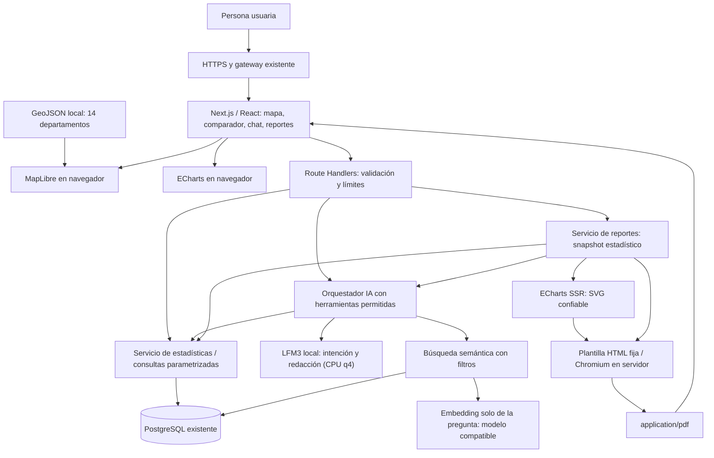

# 01 — Arquitectura, datos e inteligencia artificial

## 1. Base real del repositorio

Inspección de archivos, **sin conectarse a PostgreSQL ni verificar registros en esta planificación**:

| Elemento | Observado | Acción del plan |
| --- | --- | --- |
| Aplicación | Next.js 16.4.6, React 19.3, TypeScript, Tailwind y componentes UI existentes. `app/page.tsx` sigue siendo la portada inicial. | Extender la aplicación; reutilizar componentes adecuados. |
| Datos | `src/db/contract.prisma` define `NemotronSvMuestra` y `embedding Raw(sql\`vector(768)\`)`. La migración usa `public."NemotronSvMuestra"`. | Verificar nombre físico, tipos, permisos y correspondencia con la BD real. |
| Prisma | Runtime `@prisma/orm-postgres` rc.24 y CLI `prisma` rc.34 declarados en `package.json`; existe `src/db/db.ts` y artefactos de contrato. | Probar consultas con las versiones instaladas. No asumir APIs de Prisma 7 ni actualizar por rutina. |
| Embeddings | `src/ai/embeddings.ts` configura por defecto `onnx-community/embeddinggemma-2-ONNX`, mean pooling, normalización y prefijos de búsqueda/documento. | Verificar que modelo, revisión, dimensión y preprocesamiento coincidan con los vectores almacenados. La configuración actual no prueba su procedencia histórica. |
| Chat | `app/api/chat/route.ts` transmite respuestas de un LFM3 local, sin herramientas estadísticas. | Decisión del proyecto: LFM3 local vía `@browser-ai/transformers-js`, CPU q4, modelo desde `LFM3_MODEL_DIR` (por defecto `models`), sin API externa/OpenAI. Los endpoints con herramientas están en implementación y aún deben cumplir controles y pruebas del plan. |
| PostgreSQL local | Compose declara PostgreSQL 17 con pgvector y volumen persistente. | Mantener la BD existente; no levantar otra en producción por defecto. |
| Índices | La migración de muestra revisada declara PK; no demuestra qué índices tiene hoy la instancia. | Consultar catálogos e inspeccionar planes antes de proponer DDL. |
| Visualización/PDF | MapLibre, ECharts y motor PDF no figuran en las dependencias declaradas. | Añadir solo las dependencias necesarias en sus tareas. |

Los 50,000 registros y sus embeddings se consideran **estado declarado por el solicitante**, pendiente de comprobación en D2-01. Los modelos `User` y `Post` existentes no forman parte del MVP: no eliminarlos ni reutilizarlos artificialmente.

## 2. Arquitectura técnica

Monolito modular Next.js, una instancia de aplicación para el piloto y PostgreSQL existente.



### Reglas de implementación

- Route Handlers y servicios de datos/IA/PDF solo en servidor, runtime Node.js. Ninguna clave ni vector completo en el cliente.
- MapLibre y ECharts interactivo en componentes cliente; cargar sus módulos donde se usan, no en toda la navegación.
- El mapa une agregados y geometrías por `departmentId`; PostgreSQL no almacena ni procesa geometrías.
- El mismo servicio estadístico alimenta mapa, comparación, herramientas IA y reportes. No copiar SQL por funcionalidad.
- Reportes invocan servicios directamente, no peticiones HTTP a la propia aplicación.
- Estado de filtros en un contrato compartido y URL de la interfaz; sin biblioteca global de estado por defecto.
- `fetch` con cancelación y rechazo de resultados obsoletos. El cambio de filtros no puede dibujar una respuesta anterior.
- Sin caché de resultados al principio. Medir antes de añadirla; los assets estáticos sí pueden cachearse.

## 3. Reutilización segura de PostgreSQL

### Auditoría de solo lectura — D2-01

- [ ] Confirmar conexión al entorno correcto y rol de lectura.
- [ ] Registrar tabla, columnas, nulabilidad, tipos y PK reales.
- [ ] Verificar total de filas, duplicados, faltantes y dominios categóricos.
- [ ] Inspeccionar ingresos negativos/no finitos, edades inválidas y categorías inconsistentes.
- [ ] Confirmar unidad y período de ingresos; si se desconocen, documentar «USD estimados; período no documentado».
- [ ] Confirmar extensión vectorial, dimensiones, vectores ausentes y normalización.
- [ ] Inventariar índices SQL/vectoriales, operador de distancia y configuración.
- [ ] Comparar contrato Prisma y esquema físico sin alterar ninguno.
- [ ] Medir consultas representativas y documentar planes.

Ejemplos de inspección, para ejecutar con credenciales autorizadas, nunca con secretos en documentación:

```sql
SELECT column_name, data_type, udt_name, is_nullable
FROM information_schema.columns
WHERE table_schema = 'public' AND table_name = 'NemotronSvMuestra';

SELECT indexname, indexdef
FROM pg_indexes
WHERE schemaname = 'public' AND tablename = 'NemotronSvMuestra';

SELECT extname, extversion FROM pg_extension WHERE extname = 'vector';

SELECT departamento, COUNT(*) AS registros
FROM public."NemotronSvMuestra"
GROUP BY departamento
ORDER BY departamento;
```

`EXPLAIN (ANALYZE, BUFFERS)` solo sobre SELECT acotados, con timeout y en entorno autorizado: ejecuta la consulta y consume recursos. No hacer barridos de producción en horas sensibles.

### Acceso y compatibilidad Prisma

Reutilizar `src/db/db.ts` para las consultas soportadas. Comprobar en un spike agregaciones, agrupaciones, parametrización, transacciones de lectura y acceso al campo `Raw`.

Si la superficie Prisma instalada no cubre distancia vectorial o SQL necesario, usar **una ruta SQL parametrizada soportada por el runtime/driver**. Antes de añadir un driver, comprobar si el existente expone el acceso requerido; si hace falta una dependencia directa, declarar la mínima y documentar por qué. No inventar métodos de Prisma 7 ni forzar una migración para convertir `Raw` a otro tipo.

Los artefactos `contract.json` y `contract.d.ts` se conservan. Su regeneración, si hace falta por compatibilidad, debe revisarse y no implica modificar la BD. No ejecutar automáticamente migraciones históricas sobre la instancia poblada.

### Optimización condicionada

1. Inventariar y medir índices actuales.
2. Reutilizar planes adecuados; para 50,000 filas un escaneo secuencial puede ser correcto.
3. Revisar consultas repetidas, columnas seleccionadas y filtros antes de crear índices.
4. Solo si incumplen objetivos, proponer un índice concreto con plan antes/después, impacto y reversión.
5. Dev 1 revisa el cambio; DDL con autorización, fuera del rol de aplicación y sin reconstruir la tabla.

No se presupone un HNSW/IVFFlat existente ni se agenda crear uno por defecto.

## 4. Diccionario estadístico

### Campos y dimensiones

| Campo físico | Uso | Regla |
| --- | --- | --- |
| `id` | Conteo y referencia interna | No devolver perfiles individuales al navegador. |
| `departamento` | Agrupación territorial | Mapear a ID estable en aplicación; no renombrar masivamente en BD. |
| `edad`, `sexo` | Descripción disponible del conjunto | No añadir segmentadores nuevos al MVP; uso descriptivo solo si se acuerda en el catálogo. |
| `nivel_educativo` | Filtro y distribución | Categorías observadas, no jerarquías inventadas. |
| `ocupacion` | Filtro y distribución laboral | No equivale automáticamente a empleo/desempleo formal. |
| `ingreso_estimado_usd` | Rango, promedio y mediana | Valor estimado; no asumir salario mensual ni poder adquisitivo. |
| `sin_acceso_financiero` | Porcentaje sin acceso financiero | `true` significa **sin** acceso; evitar invertir el indicador. |
| `meta_principal` | Filtro exacto y distribución | Distinguir categoría observada de intención inferida semánticamente. |
| `embedding` | Recuperación semántica | No contiene por sí mismo una etiqueta estadística verificada. |

### Indicadores

| ID | Cálculo SQL conceptual | Unidad / denominador |
| --- | --- | --- |
| `sample_count` | `COUNT(*)` | Registros filtrados, no habitantes. |
| `income_mean` | `AVG(ingreso_estimado_usd)` sobre ingresos válidos | USD estimados; `validN` = ingresos válidos. |
| `income_median` | `percentile_cont(0.5)` sobre ingresos válidos | USD estimados; mismo universo que el promedio. |
| `financial_exclusion_pct` | `100.0 * COUNT(*) FILTER (WHERE sin_acceso_financiero IS TRUE) / NULLIF(COUNT(sin_acceso_financiero), 0)` | %, denominador = booleanos conocidos. |
| `category_count` | `COUNT(*)` agrupado por educación, ocupación o meta | Registros de cada categoría. |
| `category_pct` | `100.0 * category_count / total_del_universo_filtrado` | %, no proporción nacional. |

Definiciones adicionales:

- Filtros de dimensiones distintas se combinan con **AND**; varios valores de una dimensión con **OR**.
- Rango de ingresos cerrado, extremos opcionales. Faltantes no pasan un filtro numérico.
- Para cada métrica devolver `validN` y `missingN`; valores no válidos se cuentan como faltantes, no como cero.
- Toda exclusión por calidad debe estar documentada en catálogo y aplicada igual en todos los módulos; no modificar registros.
- Categorías faltantes se muestran como «Sin dato» con ID reservado `__missing__`; cadena vacía se trata igual, sin corregir la BD.
- Distribuciones incluyen «Sin dato», así sus porcentajes usan el total filtrado. Tras supresión por privacidad no se exige suma visible de 100%.
- Cero registros: conteo `0`, medias/porcentajes `null`, nunca `NaN`, infinito o 0% ficticio.
- Un departamento sin filas conserva su geometría y aparece como «Sin datos», no como ingreso cero.
- Diferencias monetarias = valor del departamento comparado menos valor de la referencia. Diferencias porcentuales = puntos porcentuales.
- No redondear antes de calcular diferencias. Redondear solo para presentar, a dos decimales cuando corresponda.
- El usuario puede elegir `sample_count`, pero la leyenda debe decir «registros de la muestra»; mayor volumen de muestra no significa mayor necesidad.

### Identificadores departamentales

Usar estos IDs de aplicación, independientes del esquema físico y de la codificación original del GeoJSON:

`ahuachapan`, `cabanas`, `chalatenango`, `cuscatlan`, `la-libertad`, `la-paz`, `la-union`, `morazan`, `san-miguel`, `san-salvador`, `san-vicente`, `santa-ana`, `sonsonate`, `usulutan`.

D1-04 documenta fuente, versión y licencia de la geometría. D2-01 mantiene correspondencias explícitas con nombres SQL, incluidos acentos y alias observados. No unir por texto aproximado en tiempo de ejecución. Una categoría departamental desconocida se reporta como no mapeada; no se asigna silenciosamente a otro departamento.

### Privacidad y límites interpretativos

Piloto con acceso restringido, sin exportaciones de microdatos. Aplicar un umbral inicial de publicación `k = 5`:

- Cohortes entre 1 y 4 registros: ocultar tamaño y métricas; indicar «Muestra insuficiente».
- Categorías con numerador pequeño: ocultar valores sensibles; aplicar supresión complementaria cuando un total permita reconstruirlos por resta.
- El porcentaje de exclusión financiera también se oculta si su numerador o complemento tiene entre 1 y 4 casos; no revelar el grupo pequeño mediante el porcentaje o los denominadores.
- Aplicar la misma política a tablas, gráficos, chat, metadatos y PDF; el LLM no recibe valores suprimidos.
- El umbral reduce exposición, **no garantiza anonimato** frente a múltiples consultas. No abrir acceso público sin revisión de privacidad y decisión explícita.

Mostrar siempre: «Datos de muestra; no necesariamente representativos de El Salvador. Ingresos estimados. Asociaciones no implican causalidad». No usar «población nacional», márgenes de error o proyecciones si no existe un diseño muestral documentado.

## 5. Separación entre estadísticas y semántica

| Pregunta | Ruta correcta | Límite |
| --- | --- | --- |
| «Comparar ingresos de Santa Ana y San Salvador» | SQL con filtros y métricas de ingresos | No necesita vectores. |
| «Mayor interés en capacitación técnica» | Si existe categoría validada: distribución SQL; si no, búsqueda semántica exploratoria | No convertir top-k en ranking de prevalencia territorial. Pedir precisión si no hay categoría medible. |
| «Dónde investigar demanda para un negocio» | SQL descriptivo + ejemplos semánticos filtrados, si aportan | Son hipótesis para investigar, no demanda validada ni recomendación de inversión. |
| «Qué necesidades educativas/laborales estudiar primero» | Distribuciones y metas exactas + temas semánticos etiquetados como exploratorios | Sin causalidad ni priorización objetiva inventada. |

### Búsqueda vectorial e híbrida

1. Confirmar la procedencia del embedding almacenado. Igual dimensión **no** significa espacio vectorial compatible.
2. Generar solo el vector de la pregunta con el modelo/revisión/pooling/prefijo compatibles.
3. Reutilizar el mecanismo de distancia y el índice existentes si son adecuados.
4. Aplicar todos los filtros estructurados dentro de la consulta, no filtrar un top-k global en JavaScript.
5. Ordenar por distancia y acotar candidatos; tratar distancia como similitud, no probabilidad ni «confianza».
6. Si hay índice aproximado, comprobar pérdida de resultados bajo filtros selectivos. Usar búsqueda exacta acotada cuando sea viable; no afirmar exhaustividad del top-k.
7. Proyectar únicamente campos permitidos y sintetizar evidencia agregada/redactada; la inferencia LFM3 es local y no envía perfiles a una API externa.
8. Candidatos vacíos o irrelevantes: abstenerse. No fabricar evidencia para rellenar.

Si se cuentan los IDs recuperados, solo significa «candidatos recuperados», nunca tamaño de la necesidad en el conjunto. Para un conteo temático exacto hace falta una definición estructurada verificable y consultar todo el universo pertinente.

## 6. Orquestación IA controlada

Herramientas internas, no endpoints públicos de SQL o vectores:

| Herramienta | Argumentos permitidos | Salida |
| --- | --- | --- |
| `get_statistics` | Filtros, agrupación y métricas del contrato | Agregados, tamaños publicables, referencia y advertencias. |
| `compare_departments` | Entre 2 y 14 IDs, filtros y métricas permitidos | Comparación determinista y referencia explícita. |
| `search_semantic_evidence` | Texto, filtros, `topK` acotado | Evidencia semántica sanitizada y advertencia de no representatividad. |

Flujo: validar entrada → resolver intención con catálogo limitado → validar herramienta/argumentos → ejecutar con presupuesto → construir evidencias → pedir redacción estructurada → validar salida → responder.

- El modelo **nunca recibe credenciales, conexión, permisos DDL ni una herramienta `execute_sql`**.
- SQL y nombres de columnas solo provienen de plantillas/listas permitidas del servidor. Valores enlazados como parámetros.
- Máximo 4 llamadas a herramientas y una repetición de redacción si la respuesta es inválida, dentro del presupuesto global.
- Números y gráficos salen de hechos calculados en servidor. La redacción referencia `evidenceId`/`factId`; no aceptar cifras nuevas del modelo.
- Una frase numérica sin hecho válido se rechaza. Si no puede verificarse tras una repetición, devolver tabla y explicación determinista.
- El gráfico se construye desde un `ChartSpec` acotado por el servidor; nunca ejecutar JS, HTML, SQL o configuración ECharts libre del modelo.
- El contenido recuperado se trata como datos no confiables: instrucciones incrustadas se ignoran.
- Si la pregunta exige causalidad, representatividad nacional o datos inexistentes, explicar el límite y ofrecer una consulta descriptiva posible.
- Registrar solicitud, herramientas, duraciones y resultados de validación por `requestId`; no registrar vectores, secretos ni prompts con microdatos.

**Modelo de IA (decisión):** usar LFM3 local mediante `@browser-ai/transformers-js`, CPU q4, desde `LFM3_MODEL_DIR` (por defecto `models`). No integrar API externa/OpenAI ni condicionar el trabajo a claves, aprobación de proveedor, región, retención externa o cuotas. Antes de darlo por listo, validar archivos completos/compatibles del modelo, carga local, recursos CPU/memoria/disco, latencia y liberación de recursos en el entorno candidato. Estas verificaciones siguen pendientes. Las reglas de privacidad, minimización, grounding y abstención se mantienen; las preguntas y evidencias no se envían a servicios externos.

**Reportes:** el servidor obtiene una sola instantánea estadística para el documento, reutiliza sus hechos para narrativa y gráficos, y genera el PDF sin aceptar cifras del cliente. El LLM no recalcula indicadores.

## 7. Organización propuesta

Conservar `app/` y `components/` actuales; no trasladar el proyecto entero a `src/app`.

```text
app/
  page.tsx                         # explorador/mapa
  comparar/page.tsx
  chat/page.tsx
  reportes/page.tsx
  api/
    catalog/route.ts
    statistics/route.ts
    compare/route.ts
    chat/route.ts
    reports/pdf/route.ts
    health/route.ts
components/
  ui/                              # reutilizar componentes actuales
  filters/
  map/
  charts/
  compare/
  chat/
  reports/
src/
  contracts/                       # esquemas Zod compartidos y fixtures sintéticos
  db/
    db.ts                          # existente; Dev 2
    contract.*                     # existentes, conservar
    queries/                       # SQL/ORM de estadísticas y vectores
  data/
    departments.ts                 # IDs y mapeo acordados
    indicators.ts                  # definiciones permitidas
  server/
    validation.ts
    statistics.ts
    comparison.ts
    chat.ts
    reports.ts
    privacy.ts
  ai/
    embeddings.ts                  # existente, solo preguntas nuevas
    provider.ts
    tools.ts
  charts/
    spec.ts                        # contrato reducido compartido
    options.ts                     # gráficos permitidos navegador/SSR
public/
  geo/sv-departamentos.geojson
tests/                             # casos de alto valor, sin replicar suites
docs/
  plan/                            # este plan
  data-audit.md                     # resultado futuro D2-01
  operations.md                     # resultado futuro fase 6
```

Crear archivos solo cuando exista su primera implementación. `src/contracts` no importa módulos de servidor. Los servicios no dependen de componentes React. El actual `/api/chat` debe adaptarse al contrato final y al servicio seguro; no dejar el chat local sin controles como vía alternativa.

## 8. Referencias y verificaciones pendientes

- Next.js local: `node_modules/next/dist/docs/01-app/03-api-reference/03-file-conventions/route.md` y `01-app/02-guides/self-hosting.md`, consultados para este plan.
- Context7: documentación de Next.js `/vercel/next.js/v16.4.5`, versión indexada cercana; en diferencias prevalecen las guías locales de 16.4.6.
- Prisma 8 instalado: `.agents/skills/prisma-8/references/queries-postgres.md`; confirmar versión de referencia/runtime antes de implementar.
- Dev 1 verifica APIs actuales de MapLibre/ECharts al abordar visualización; Dev 2 verifica integración de `@browser-ai/transformers-js`, archivos/modelo local y motor PDF al implementarlos. Este documento no presupone firmas de SDK no comprobadas.
