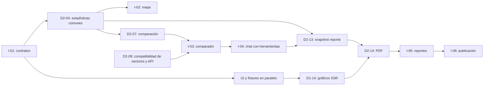

# 03 — Fases e integración

## 1. Capacidad y prioridades

- Cada fase agrupa entregables y dependencias, sin duración de calendario fija.
- Cada dev tiene una estimación de **28 h de tareas individuales + 4 h de integración** por fase.
- Reserva orientativa: 8 h adicionales por dev/fase, no asignadas a funcionalidades nuevas.
- `P0`: bloqueante de seguridad, datos, contrato o publicación. `P1`: necesario para las cuatro funcionalidades del MVP.
- Las horas son estimaciones de esfuerzo, no fechas límite; incluyen implementación, verificación local y documentación breve. Los issues explícitos de pruebas cubren escenarios transversales, no duplican pruebas por función.
- Revisión cruzada cotidiana usa la reserva; acuerdos/demos de integración I-01…I-06 usan sus 4 h asignadas.
- Avanzar según dependencias y criterios de aceptación, sin fijar semanas.
- En las tablas, S1–S6 identifican las fases 1–6, no sprints ni semanas.

## 2. Fases y puertas de salida

| Fase | Objetivo | Puerta de salida |
| --- | --- | --- |
| 1 — Base y contrato | Entender datos, fijar contratos y habilitar trabajo paralelo. | I-01 aprobado; auditoría, UI con fixtures y catálogo real. |
| 2 — Exploración territorial | Primera funcionalidad completa de extremo a extremo. | I-02: mapa + filtros + detalle con estadísticas verificadas. |
| 3 — Comparación y preparación IA | Comparación real y viabilidad de vectores/proveedor. | I-03: comparador y spike IA aprobados. |
| 4 — Chat confiable | Consultas naturales con evidencia y límites. | I-04: chat integrado, pruebas de exactitud y abstención. |
| 5 — Reportes | Configurar y descargar PDF con narrativa y gráficos. | I-05: PDF completo desde una instantánea estadística. |
| 6 — Endurecimiento y publicación | Verificar, medir y operar el MVP. | I-06: aceptación, seguridad y despliegue comprobados. |

No se espera a terminar todos los endpoints para desarrollar frontend. Los fixtures aprobados en I-01 permiten avanzar desde la primera fase. Los contratos de comparador, chat y PDF también se acuerdan en I-01, aunque sus servicios se implementen después.

## 3. Trabajo paralelo por fase

| Fase | Dev 1 — frontend/visualización | Dev 2 — backend/datos/IA | Integración y entregable demostrable |
| --- | --- | --- | --- |
| 1 | D1-01 shell/navegación (10 h); D1-02 filtros/estado (10 h); D1-03 contratos/fixtures (8 h). | D2-01 auditoría (12 h); D2-02 acceso seguro/spike Prisma (8 h); D2-03 catálogo (8 h). | I-01, 4 h cada uno: contrato aprobado; al cierre UI usa catálogo y fixtures sin microdatos. |
| 2 | D1-04 mapa/GeoJSON (14 h); D1-05 detalle/gráficos (10 h); D1-06 pruebas mapa (4 h). | D2-04 consultas/filtros/privacidad (16 h); D2-05 endpoint estadísticas (8 h); D2-06 regresiones SQL/API (4 h). | I-02, 4 h cada uno: filtros cambian coropleta y panel, cifras cotejadas con SQL. |
| 3 | D1-07 comparador (16 h); D1-08 filtros cruzados/referencia (8 h); D1-09 regresiones comparador (4 h). | D2-07 endpoint comparación (12 h); D2-08 pruebas comparativas (6 h); D2-09 spike embeddings/proveedor (10 h). | I-03, 4 h cada uno: comparación real; modelo de consulta compatible y proveedor API aprobados. |
| 4 | D1-10 interfaz chat (16 h); D1-11 tablas/gráficos/fuentes (8 h); D1-12 errores/abstención (4 h). | D2-10 herramientas SQL/proveedor (12 h); D2-11 búsqueda híbrida (8 h); D2-12 validación/antialucinaciones (8 h). | I-04, 4 h cada uno: preguntas económicas, educativas y exploratorias con fuentes y límites. |
| 5 | D1-13 configuración/descarga (12 h); D1-14 gráficos compartidos SSR (8 h); D1-15 pruebas reporte (8 h). | D2-13 snapshot del reporte (8 h); D2-14 PDF del servidor (14 h); D2-15 pruebas PDF/degradación (6 h). | I-05, 4 h cada uno: PDF descargable, legible y consistente; sin almacenamiento extra. |
| 6 | D1-16 accesibilidad/rendimiento visual (10 h); D1-17 E2E (8 h); D1-18 correcciones/guía (10 h). | D2-16 despliegue/seguridad (12 h); D2-17 carga/planes (8 h); D2-18 correcciones/runbook (8 h). | I-06, 4 h cada uno: piloto publicado con smoke tests y rollback ensayado. |

**Total por persona:** 168 h individuales + 24 h de integración = 192 h estimadas. No es necesario esperar a que el otro desarrollador complete todo su módulo.

## 4. Puntos de integración como GitHub Issues

Estos seis issues son compartidos; su esfuerzo es **4 h por dev**, no 4 h totales.

| ID | Título / prioridad | Responsable y duración | Dependencias | Entregable |
| --- | --- | --- | --- | --- |
| I-01 | Aprobar contrato y base de integración — P0 | Ambos, 4 h/persona, fase 1 | Ninguna; usa corte inicial de D2-01 y este contrato. | Contrato, ejemplos sintéticos y definiciones aprobados antes de implementar consumidores/endpoints. |
| I-02 | Integrar explorador con estadísticas reales — P0 | Ambos, 4 h/persona, S2 | I-01, D1-04…06, D2-04…06. | Demo territorial + evidencia de cifras, vacíos y supresión. |
| I-03 | Integrar comparador y aprobar viabilidad IA — P0 | Ambos, 4 h/persona, S3 | I-02, D1-07…09, D2-07…09. | Demo de comparación; registro de proveedor/modelo, permisos de datos y compatibilidad vectorial. |
| I-04 | Integrar chat y validar evidencia — P0 | Ambos, 4 h/persona, S4 | I-03, D1-10…12, D2-10…12. | Casos de preguntas verificables, ambiguas, no soportadas y de inyección. |
| I-05 | Integrar generación y descarga PDF — P0 | Ambos, 4 h/persona, S5 | I-04, D1-13…15, D2-13…15. | Reporte de muestra con secciones/filtros, gráfico y análisis trazables. |
| I-06 | Aceptar y publicar el MVP — P0 | Ambos, 4 h/persona, S6 | I-05, D1-16…18, D2-16…18. | URL piloto, evidencia de aceptación, checklist de release y plan de rollback. |

### Distribución de las 4 h de integración

- I-01: 2 h iniciales de contrato + 2 h de aprobación. El cierre de fase comprueba entregables individuales sin mantener bloqueado este issue.
- I-02…I-05: 1 h de revisión del contrato/casos + 2 h de prueba conjunta + 1 h de demo y cierre.
- I-06: 1 h de decisión go/no-go + 2 h de smoke/revisión conjunta + 1 h de entrega operativa.

No marcar un hito si faltan sus criterios, aunque la demo parcial funcione.

## 5. Secuencia de trabajo dentro de cada fase

1. Acordar ejemplos/casos límite, abrir issues y revisar dependencias.
2. Implementar en paralelo y abrir PR pequeñas.
3. Conectar la API real, ejecutar pruebas y corregir discrepancias.
4. Integrar, demostrar criterios verificables y actualizar checkboxes/evidencia.

En la fase 1, aprobar el contrato antes de implementar consumidores y endpoints. En la fase 5, Dev 1 entrega primero el contrato de gráficos y su primer ejemplo SSR para que Dev 2 no espere a terminar todo D1-14.

## 6. Dependencias críticas y gestión de bloqueos

| Bloqueo | Respuesta inmediata | Cuándo reestimar |
| --- | --- | --- |
| Acceso PostgreSQL no disponible | Dev 1 avanza fixtures; Dev 2 revisa contrato/migraciones y prepara queries sin ejecutarlas. | Si impide completar la fase 1. No aprobar auditoría con supuestos. |
| Categorías/período de ingresos desconocidos | Mostrar categorías verificadas y período no documentado. | Si impide definir filtros/indicadores al cerrar I-01. |
| Incompatibilidad Prisma RC | Spike acotado D2-02; reutilizar SQL parametrizado compatible. | Si consume la reserva S1; no migrar o actualizar toda la plataforma sin evidencia. |
| Embeddings sin procedencia compatible | Mantener trabajo SQL/UI y recuperar configuración histórica. | I-03 no se aprueba como completo; no regenerar el conjunto ni simular búsqueda. |
| Proveedor sin autorización o cuota | Implementar herramientas/fixtures, no enviar registros. | Si no se resuelve antes de I-03. El alcance IA requiere nueva fecha. |
| PDF no cabe en runtime | Usar despliegue Node.js persistente con Chromium; reducir complejidad de plantilla. | Si supera recursos/presupuesto medido aun con límites. |

La reserva absorbe incidentes moderados; no es autorización para omitir búsqueda semántica, secciones PDF, pruebas o alguna de las cuatro funcionalidades.

## 7. Trabajo colaborativo sin duplicación

- Dev 1 posee componentes y contratos de presentación; Dev 2 posee acceso a datos y servicios.
- `departments.ts`, indicadores y cualquier contrato compartido se modifican con revisión del otro, evitando ediciones simultáneas.
- Dev 1 prueba recorridos y presentación; Dev 2 prueba exactitud, validación, privacidad y herramientas.
- Un bug de definición estadística se arregla en el servicio común, no con cálculos distintos en mapa/comparador/chat/PDF.
- Cada issue incluye dependencias por ID, criterio específico de sus archivos de trabajo y evidencia de verificación.
- Si una tarea se divide en subissues, conservar su estimación total o registrar el cambio de alcance; nunca contar padre e hijos dos veces.
